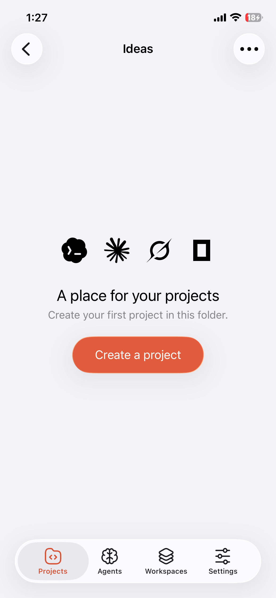
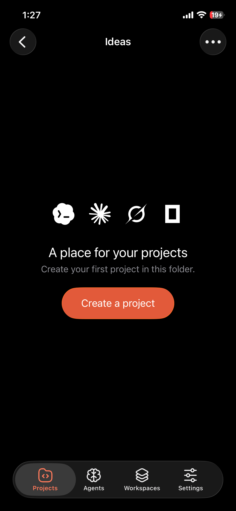
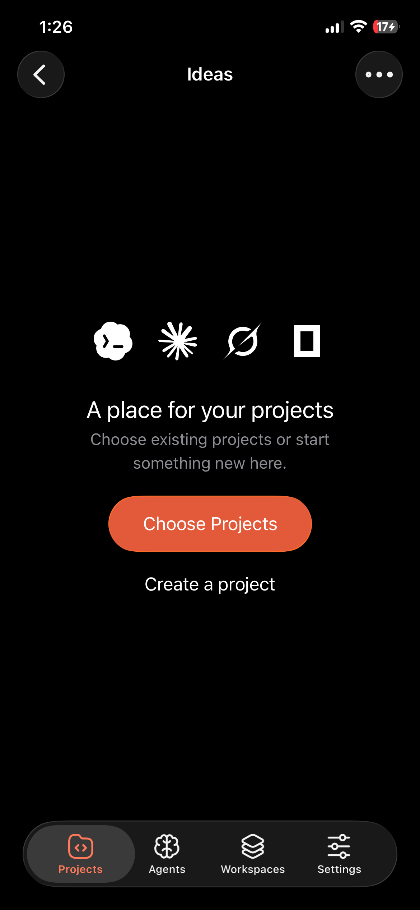
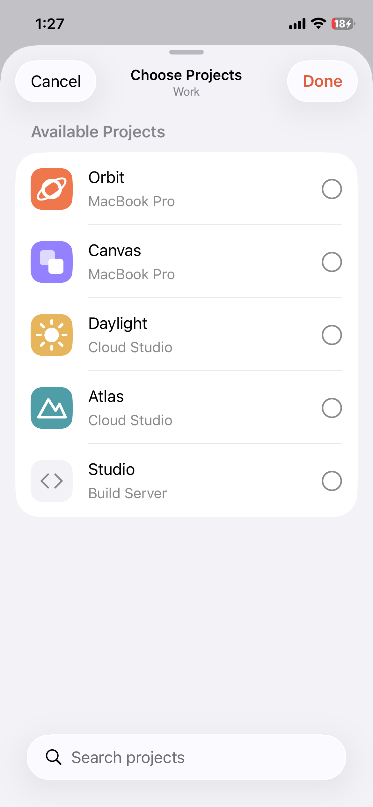
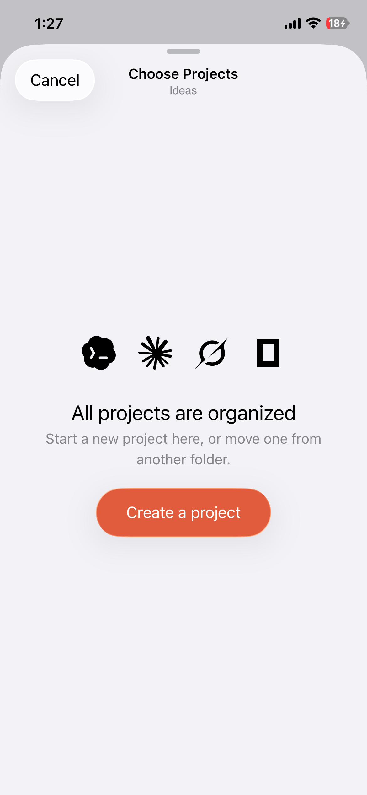
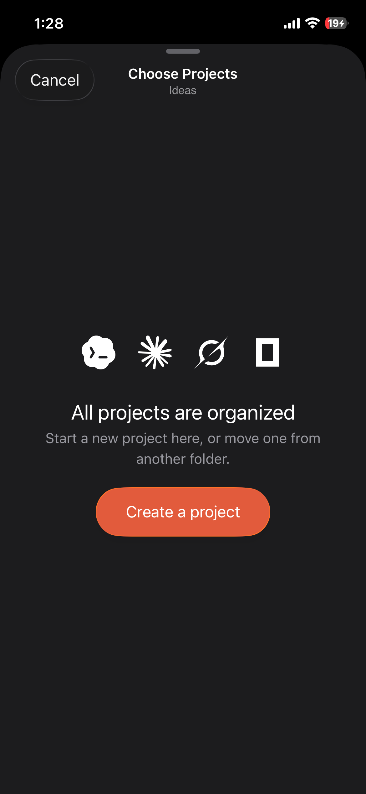
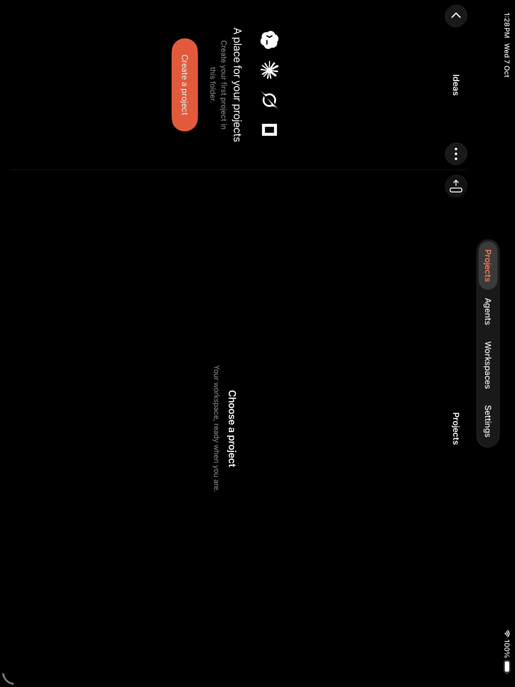
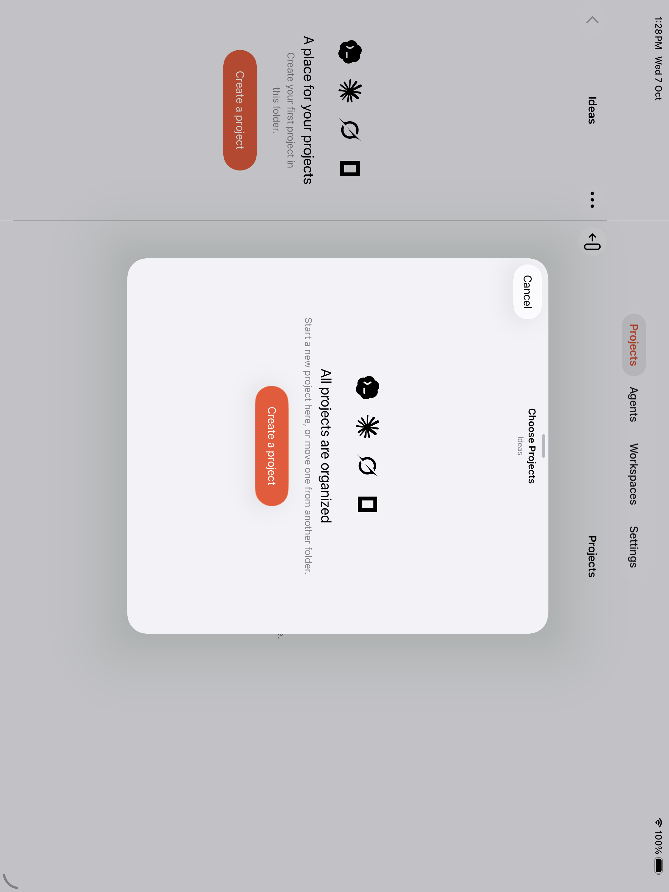
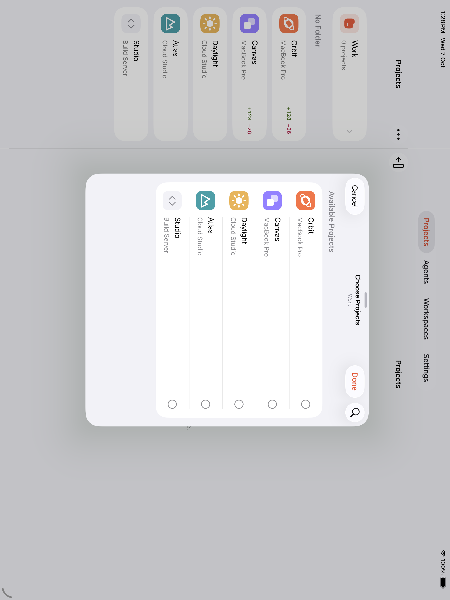

# Folder empty states and project selection

Captured from the production SwiftUI screens with isolated sample projects, 2026-10-07.

- Empty folders reuse the Projects home artwork and layout.
- Folders with unassigned projects offer Choose Projects and Create a project.
- When no projects are available, direct creation replaces the empty selection step. The Choose Projects sheet also offers creation, with no empty search field or redundant Done button.
- Creation opens after the picker dismisses and retains its folder destination, including when the picker was opened from the library root. Cancel returns to the previous screen.
- Picker artwork uses the shared 44-point card size and centered text alignment.

## iPhone 12, physical device

| Empty folder · light | Empty folder · dark |
| --- | --- |
|  |  |

| Existing projects available | Larger project artwork |
| --- | --- |
|  |  |

| Empty picker · light | Empty picker · dark |
| --- | --- |
|  |  |

## iPad

## Verification

The Debug app builds for physical devices and simulators. On the physical iPhone, all 10 selected unit/appearance checks and both new folder interaction tests passed. These cover project membership, queued clone placement, the existing empty home at larger text sizes, creation from an empty folder, and creation after all projects have been organized. UI creation checks verify the destination and cancellation; they do not provision a real workspace or clone a repository.

All three selected interaction tests passed on the iPad simulator, including exclusion of projects assigned to other folders, reordering, and keeping folder navigation in the sidebar. The older membership test was interrupted by an incoming phone call on the physical device; the subsequent physical retry could not launch because the phone was locked.

That interrupted membership and drag regression then passed on the iPhone 17 Pro Max simulator.

Test results: `/tmp/Mindwire-Folder-UX-iPhone-20261007.xcresult`, `/tmp/Mindwire-Folder-UX-iPad-20261007.xcresult`, and `/tmp/Mindwire-Folder-UX-iPhone-Simulator-20261007.xcresult`.
