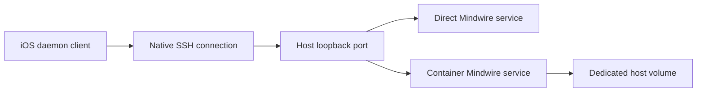

# Workspaces on SSH servers

An owned SSH server supports two placements in New Workspace:

| Placement | Environment | Persistent data |
| --- | --- | --- |
| Direct (default) | The server is one workspace. No Docker prerequisite. | The SSH user's home and the daemon's existing workspace registry. |
| Docker sandbox | One fresh container per workspace, with CPU and memory limits. | A dedicated Docker volume on the host, mounted at `/home/node`; includes projects, CLI authentication, chat history and Mindwire state. |

Add Server verifies SSH access and command execution before saving the connection. Hostnames,
usernames and ports are normalized consistently for testing and saving. Optional SSH-key setup
installs the generated public key and authenticates a new connection with it before switching
credentials. Failed or cancelled setup leaves no placeholder server, and a failed edit preserves
the existing connection. Setup progress stays in the form; secrets are saved in the device Keychain.

You can create a workspace from New Workspace or from **Settings → Computers & Servers →
your server → Create Workspace**. Both use the same wizard, with the saved server preselected.
Creating from the server page opens the workspace automatically. Direct placement reuses the server's single workspace;
Docker placement creates a separate sandbox. Workspace creation queues Mindwire service setup
even when automatic updates are disabled.

The app uses SwiftNIO SSH `direct-tcpip` forwarding and native URLSession HTTP/SSE for both
placements. Direct forwards to the server's loopback service port. Docker publishes the container's
service on a random host **loopback** port, then uses the same SSH channel and daemon protocol.
Chat streams and control requests can run concurrently; cancelling one stream does not disconnect
other chats. A failed request invalidates a dead tunnel, without replaying an ambiguous mutation.

The terminal also uses the native SSH connection. A sandbox terminal runs `docker exec -it` in the
verified owned container. File and provisioning commands use that same container placement. The
host filesystem and Docker socket are not mounted into the sandbox. Credentials stay in the
Keychain on the device and private files in the workspace; the service token is not a Docker label
or environment setting visible through inventory.

Creating a sandbox explicitly checks Docker and may install/start it. Linux automatic installation
uses Docker's official installer and requires root or passwordless sudo. An existing Docker Desktop
installation can be started on macOS; its first installation/setup must be completed on the Mac.
Inventory, navigation and status checks never install Docker or start a stopped workspace. Only a
local Unix Docker socket is accepted, so the SSH tunnel and container always refer to the same host.

Docker names and ownership labels make creation retryable. A standard Node 24 Debian container
starts without a bundled Mindwire binary; the shared installer downloads the chosen service from
GitHub releases and upgrades it under the existing idle/update lock. Its executable lives on the
persistent volume, so restarting the container keeps the updated version. Containers stay
unprivileged, run as `node`, and use Docker's default namespace and syscall restrictions.

Service **0.1.17 or later** is required for `workspaceIsolationVersion: 1` and
`workspaceIsolation: container`. The trusted launcher sets `MINDWIRE_ISOLATION=container`, letting
Codex use Docker as its sandbox boundary without requiring another privileged namespace inside it.
Explicit Codex sandbox settings and approval choices are preserved. Direct servers retain their
existing defaults. The app checks both the release and the running capability before accepting
the workspace as ready.

Docker's labeled inventory owns container existence and power state. The app caches workspace
identity and a local display-name override. A successful refresh recovers containers created before
an app disconnect; only confirmed removal deletes cached workspace data. SSH/Docker failures keep
the cache. Projects, agents, chats and authentication remain owned by the daemon in each workspace.
Deleting a sandbox requires the native destructive confirmation and removes its owned container
and volume; the dialog explains that files and history are permanent deletions.

Verification covers real in-process SSH multiplexing, interrupted connections, stopped workspace
reads, retry/ownership checks, image compatibility, inventory reconciliation and OpenSSH key import.
`ServerConnectionTests` also covers failed authentication, cancellation, concurrent edits and
verification of generated keys. `ServerWorkspaceLiveTests` uses a fresh disposable Linux SSH
server to verify password-to-key setup, installation of the published service, file operations,
project metadata and SSE, Git stage/unstage, native PTY access, and reopening the workspace.
Enable it with `MINDWIRE_SERVER_LIVE_FIXTURE` pointing to a JSON file with `host`, `port`,
`username` and `password` for a disposable test account; the account needs a writable home,
Bash, Git, curl and normal outbound HTTPS. It requires no cloud or model account.

`DockerWorkspaceLiveTests` additionally runs against an opt-in disposable SSH/Docker host. It uses
the real Codex CLI with a local Responses fixture to check native shell/file tools, streamed parts,
session resume, and retained history and authentication after restart. Its optional local artifact
is a test fixture for an unreleased daemon; production has no local-upload path and always uses
published GitHub releases.
